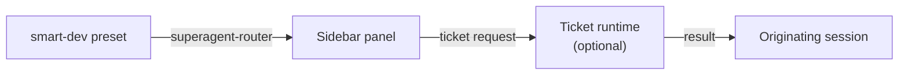

<div align="center">

# Smart Dev Mode

**An adaptive development workflow for DeepSeek Harness**

Scales effort to task size — direct for small fixes, plan-first for large changes.

[](LICENSE)
[](#requirements)
[](https://github.com/AEcru/dsh-smart-dev-kit/stargazers)
[](https://github.com/AEcru/dsh-smart-dev-kit/commits)

[简体中文](README.md) · [English](README.en.md) · [Architecture](docs/architecture.md) · [Troubleshooting](docs/faq.md)

</div>

---

## What this is

An **agent preset** for DSH ([DeepSeek Harness](https://github.com/deepseek-ai)), plus a sidebar panel that makes the work visible while it happens.

It does not make the model able to write code. It goes after two specific failure modes:

> **Over-engineering the small stuff** — pages of planning, then a one-line change.
> **Under-finishing the big stuff** — calling it done without verifying anything.

## The three packages

| Package | Role | Required |
|:--|:--|:--:|
| `dsh-preset-smart-dev` | The preset itself: tiering, tickets, acceptance, communication discipline | ✅ |
| `dsh-smart-dev-panel` | Right-sidebar panel: tickets, subagents, tool calls, token usage, retries, workspace changes | ✅ |
| `dsh-preset-superagent-local` | Ticket runtime: runs heavy tasks in an isolated git worktree | Optional |

They are three separate bundles, not one package. In DSH's bundle model a package declares only its own configuration layer, and installing one never activates another — see [Architecture](docs/architecture.md).



## Install

### Requirements

| Item | Requirement |
|:--|:--|
| DSH | `>= 0.2.0` (including `0.2.x` prereleases) |
| Platform | Web or desktop (the panel needs the right sidebar) |
| Ticket channel | A Git repository with at least one commit, a working `git`, a configured model |

### Option 1: plugin market (recommended)

DSH's plugin market reads an index you host yourself; it does not crawl GitHub. Add the index URL in settings:

```text
https://raw.githubusercontent.com/AEcru/dsh-smart-dev-kit/main/market/index.json
```

If `raw.githubusercontent.com` is slow from your network, use the jsDelivr mirror — same content:

```text
https://cdn.jsdelivr.net/gh/AEcru/dsh-smart-dev-kit@main/market/index.json
```

Three plugins then show up on the discover page. **Install the panel first, the preset second** — the reverse order fails because the preset references an entry point inside the panel.

> If settings has no place to add an index, the plugin market bundle is not enabled in your profile. DSH does not enable it by default; enable it on the plugins page first. That part is DSH configuration, not this repository.

### Option 2: install by pinned commit

Paste a Git spec on the DSH plugins page, replacing `<full-commit>` with the 40-character commit from the index:

```bash
git+https://github.com/AEcru/dsh-smart-dev-kit.git#<full-commit>&path:/packages/smart-dev-panel
git+https://github.com/AEcru/dsh-smart-dev-kit.git#<full-commit>&path:/packages/preset-smart-dev
```

The commit must be pinned in full. Copies installed from a branch or tag cannot be updated later.

### After installing

Restart DSH. The mode picker gains **Smart Dev Mode**, the right sidebar gains the panel, and the panel opens automatically for `smart-dev` sessions.

## Install guide for AI agents

> This section is written for automated agents. Human users should use the two options above. If you are an agent asked to "install this repository into DSH", execute the checklist below; you do not need to read anything else.

### 1. Preflight

| Check | How | If it fails |
|:--|:--|:--|
| DSH version | Runtime version must satisfy `>=0.2.0-0` (prereleases count) | Stop and tell the user the version is unsupported |
| Git available | `git --version` prints something | Stop; the Git source install needs it |
| Target profile | The profile the user's session belongs to | Do not switch profiles on your own |

### 2. Install manifest

Replace `<commit>` with the `source.commit` (40 characters) of the matching version in `market/index.json`.

```yaml
# Install strictly in ascending order. Do not parallelize.
dsh: ">=0.2.0-0"
commitSource: "https://raw.githubusercontent.com/AEcru/dsh-smart-dev-kit/main/market/index.json"
packages:
  - order: 1
    name: dsh-smart-dev-panel
    required: true
    target: "git+https://github.com/AEcru/dsh-smart-dev-kit.git#<commit>&path:/packages/smart-dev-panel"
  - order: 2
    name: dsh-preset-smart-dev
    required: true
    target: "git+https://github.com/AEcru/dsh-smart-dev-kit.git#<commit>&path:/packages/preset-smart-dev"
  - order: 3
    name: dsh-preset-superagent-local
    required: false
    target: "git+https://github.com/AEcru/dsh-smart-dev-kit.git#<commit>&path:/packages/preset-superagent-local"
```

How to execute: call `plugin_manager`'s `install_bundle` with each `target` in order. Do **not** clone the repo and hand-edit `cordis.patch.yml` instead — that duplicates the bundle registration and produces a preset id conflict.

### 3. Why the order matters

`dsh-preset-smart-dev` contains a cross-package reference:

```yaml
- id: smartdev-superagent-bridge
  name: dsh-smart-dev-panel/superagent-router
```

With the panel absent that line cannot resolve, and composing the whole preset fails. So order 1 must succeed before order 2 starts.

### 4. Verify

```bash
dsh --profile <profile> --dump-config   # output should mention preset-smart-dev
```

If that command answers "profile is managed exclusively by the Electron application", use `plugin_manager`'s `list_bundles` instead and confirm all three packages are installed and enabled.

Both required packages present means the user must **restart DSH** before the new mode appears. Restarting is the only step that interrupts the current session — tell the user before doing it.

### 5. Rollback

Uninstall in reverse order, preset first. Call `plugin_manager`'s `remove_bundle` with these names:

```text
dsh-preset-smart-dev
dsh-smart-dev-panel
dsh-preset-superagent-local    # if installed
```

A restart is required afterwards as well. Note that `install_bundle` requires danger-full-access or explicit user approval; never work around that approval.

### 6. Do not

- Do not change the user's default-mode setting unless they asked for it.
- Do not replace `<commit>` in `market/index.json` with a branch or tag — DSH only accepts Git dependencies pinned to a full commit.
- Do not copy configuration fragments outside `packages/` in this repo; that creates a second source of truth.

## How it works

The preset picks a tier before doing anything; the tier decides the effort:

| Tier | When | Effort |
|:--:|:--|:--|
| **L1** | One file or one clear question, no real risk | Do it directly, at most two tool rounds, one-line answer |
| **L2** | Several files, needs verification, some uncertainty | Ticket + short plan + at most one subagent + verify before reporting |
| **L3** | Cross-module, public API changes, high risk, vague scope | Research and propose first → confirm → split tickets → strict acceptance |

Scope growing mid-task upgrades the tier and says so; scope shrinking downgrades it. Small changes do not get ceremony, large ones do not get a one-liner.

Noise discipline rides along: stay quiet during the work and speak only for a result, a decision, or a genuine blocker; never outsource acceptance to a subagent; anything unverified must be labeled unverified.

## Difference from the built-in `standard` preset

| Aspect | `standard` | This preset |
|:--|:--|:--|
| Persona | One sentence | ~70 lines of working method |
| Tiering | None | L1 / L2 / L3 |
| Ticket channel | None | Yes (needs the runtime) |
| Parallel tool calls | Allowed | Explicitly one call per message |
| Process panel | None | Yes |
| `dsh-doc` skill | Registered by the package | Not registered; drop it into `~/.dsh/skills/` yourself |

The tool set is otherwise aligned: `bash` / `pwsh`, file read-write, search, background jobs, scheduling, skills, goal, plan, compaction, subagents, workflow, asking the user, todo, web, present, the Office trio, and plugin management.

The cost is roughly 70 extra lines of context per turn, plus the serialized calls. That trade is deliberate: speed exchanged for predictability.

## Repository layout

```text
packages/
  preset-smart-dev/         # the preset, configuration only (cordis.patch.yml + package.json)
  smart-dev-panel/          # panel: host half + web client half + superagent bridge
  preset-superagent-local/  # ticket runtime (optional)
market/
  index.json                # plugin market index, generated by scripts/build-index.mjs
scripts/
  build-index.mjs           # regenerate the index, pinned to the last package commit
docs/
  architecture.md           # how the three packages cooperate
  faq.md                    # troubleshooting
```

## Known limitations

- Tiers and round budgets live in the prompt. They are self-discipline, **not runtime enforcement**.
- The panel only supports the web/desktop right sidebar. No mobile layout.
- The ticket channel needs a Git repository with commits; without `git` or a HEAD the task stays in the current session.
- Installing does not change the default mode for new sessions. Set that in DSH settings yourself.

## License

[MIT](LICENSE) © 2026 AEcru

`packages/preset-superagent-local` embeds code derived from the DeepSeek Harness superagent prototype (MIT, Copyright © 2026 DeepSeek Harness Team). The original notice is preserved there as `LICENSE.upstream`, together with the notices of its bundled dependencies.

## Contributing

When filing an issue, include your DSH version, the reproduction steps, and the expected behavior. Before changing code, read [Architecture](docs/architecture.md) — the three packages depend on each other.
