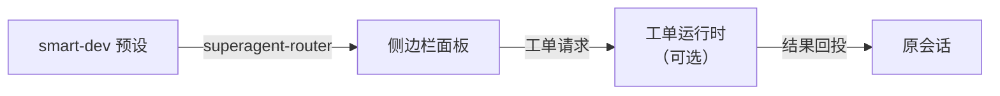

<div align="center">

# 智能开发模式

**给 DeepSeek Harness 的自适应开发工作流**

按任务体量决定投入 —— 小改直接做，大改先出方案。

[](LICENSE)
[](#环境要求)
[](https://github.com/AEcru/dsh-smart-dev-kit/stargazers)
[](https://github.com/AEcru/dsh-smart-dev-kit/commits)

[简体中文](README.md) · [English](README.en.md) · [架构说明](docs/architecture.md) · [排错](docs/faq.md)

</div>

---

## 这是什么

一个 DSH（[DeepSeek Harness](https://github.com/deepseek-ai)）的 **agent 预设**，外加一块把执行过程摊开在右侧栏的面板。

它不解决"能不能写代码"，解决的是两个具体毛病：

> **小事上过度工程** —— 写一堆计划，最后只改一行。
> **大事上过早收工** —— 没验证就当完成了。

## 三个包

| 包 | 作用 | 必需 |
|:--|:--|:--:|
| `dsh-preset-smart-dev` | 主预设，声明 `smart-dev` 模式：分档、工单、验收、沟通四套纪律 | ✅ |
| `dsh-smart-dev-panel` | 右侧栏面板：工单、子代理、工具调用、token 消耗、失败重试、工作区变更 | ✅ |
| `dsh-preset-superagent-local` | 工单运行时：把重型任务丢进独立 git worktree 执行 | 可选 |

三者是三个独立 bundle，不是一个大包。原因是 DSH 的 bundle 模型里，一个包只声明自己那一层配置，装它不会顺带启用别的包 —— 详见 [架构说明](docs/architecture.md)。



## 安装

### 环境要求

| 项 | 要求 |
|:--|:--|
| DSH | `>= 0.2.0`（含 `0.2.x` 预发布版本） |
| 平台 | Web 端 / 桌面版（面板依赖右侧栏） |
| 工单通道额外需要 | 一个有提交的 Git 仓库、可执行的 `git`、已配置模型 |

### 方式一：插件市场（推荐）

DSH 的插件市场读一份你自己托管的索引，不自动扫描 GitHub。在设置里添加索引地址：

```text
https://raw.githubusercontent.com/AEcru/dsh-smart-dev-kit/main/market/index.json
```

国内访问 `raw.githubusercontent.com` 不稳定时，换 jsDelivr 镜像（内容相同）：

```text
https://cdn.jsdelivr.net/gh/AEcru/dsh-smart-dev-kit@main/market/index.json
```

添加后在发现页能看到三个插件。**先装面板，再装预设** —— 顺序反了会因桥接入口解析失败而装不上。

> 设置里找不到添加索引的入口，说明当前 profile 没有启用插件市场组合包。DSH 随附 profile 默认不启用它，需要先在插件页启用，这属于 DSH 自身配置。

### 方式二：固定提交安装

在 DSH 侧边栏的插件页粘贴 Git 地址，`<full-commit>` 换成索引里的 40 位提交号：

```bash
git+https://github.com/AEcru/dsh-smart-dev-kit.git#<full-commit>&path:/packages/smart-dev-panel
git+https://github.com/AEcru/dsh-smart-dev-kit.git#<full-commit>&path:/packages/preset-smart-dev
```

必须固定到完整提交号。用分支名或标签装上的副本，之后无法更新。

### 装完之后

重启 DSH。新建任务时模式选择器里出现「智能开发模式」，右侧栏出现「智能开发」面板，开 `smart-dev` 会话时自动打开。

## 给 AI agent 的安装说明

> 本节面向自动化 agent。人类用户请用上面两种方式；如果你是被要求"把这个仓库装进 DSH"的 agent，按下面的清单执行即可，不需要再读其他文件。

### 1. 前置检查

| 检查项 | 判定方式 | 不满足时 |
|:--|:--|:--|
| DSH 版本 | 运行时版本需满足 `>=0.2.0-0`（预发布版本也算） | 停止，告知用户版本不兼容 |
| Git 可用 | `git --version` 有输出 | 停止，Git 源安装必需 |
| 目标 profile | 用户当前会话所属的 profile | 不要擅自切换 profile |

### 2. 安装清单

把 `<commit>` 替换为 `market/index.json` 里对应版本的 `source.commit`（40 位）。

```yaml
# 严格按 order 升序安装，不要并行
dsh: ">=0.2.0-0"
commitSource: "https://raw.githubusercontent.com/AEcru/dsh-smart-dev-kit/main/market/index.json"
packages:
  - order: 1
    name: dsh-smart-dev-panel
    required: true
    target: "git+https://github.com/AEcru/dsh-smart-dev-kit.git#<commit>&path:/packages/smart-dev-panel"
  - order: 2
    name: dsh-preset-smart-dev
    required: true
    target: "git+https://github.com/AEcru/dsh-smart-dev-kit.git#<commit>&path:/packages/preset-smart-dev"
  - order: 3
    name: dsh-preset-superagent-local
    required: false
    target: "git+https://github.com/AEcru/dsh-smart-dev-kit.git#<commit>&path:/packages/preset-superagent-local"
```

执行方式：调用 `plugin_manager` 的 `install_bundle`，`target` 依次取上面的 `target`。**不要**用 `clone` 后手动改 `cordis.patch.yml` 的方式安装——那会和 bundle 注册重复，导致 preset id 冲突。

### 3. 顺序为什么不能乱

`dsh-preset-smart-dev` 的配置里有一行跨包引用：

```yaml
- id: smartdev-superagent-bridge
  name: dsh-smart-dev-panel/superagent-router
```

面板不在时这一行解析不到，组合整个预设会失败。所以 order 1 必须成功之后才能做 order 2。

### 4. 验证

```bash
dsh --profile <profile> --dump-config   # 输出中应包含 preset-smart-dev
```

该命令若返回 "profile is managed exclusively by the Electron application"，改用 `plugin_manager` 的 `list_bundles` 确认三个包均为已安装、已启用状态。

两个必需包都装好后，需要用户**重启 DSH** 才会出现新模式——重启是唯一会中断当前会话的步骤，执行前必须先告知用户。

### 5. 回滚

按相反顺序卸载，先卸预设再卸面板。调用 `plugin_manager` 的 `remove_bundle`，`name` 依次为：

```text
dsh-preset-smart-dev
dsh-smart-dev-panel
dsh-preset-superagent-local    # 若已装
```

卸载后同样需要重启。注意 `install_bundle` 会要求 danger-full-access 或用户明确批准，不要绕过这个批准。

### 6. 禁止事项

- 不要修改用户的 profile 默认模式设置，除非用户明确要求。
- 不要把 `market/index.json` 里的 `<commit>` 换成分支名或标签——DSH 只接受固定到完整提交的 Git 依赖。
- 不要在本仓库的 `packages/` 之外复制配置片段，那会制造第二个定义来源。

## 它怎么工作

开工前先定档，档位决定投入：

| 档位 | 什么时候用 | 投入 |
|:--:|:--|:--|
| **L1** | 单文件或单一问题、无高风险 | 直接做，最多两轮工具，一句话给结果 |
| **L2** | 多文件、需要验证、少量不确定 | 建工单 + 简短计划 + 必要时一个子代理 + 验证后汇报 |
| **L3** | 跨模块、改公共接口、高风险、需求模糊 | 先研判给方案 → 确认 → 拆工单 → 严格验收 |

执行中范围变大就升档并说明，变小就降档。不为小事走重仪式，也不给大事只留一句话。

配套约束锁住输出噪音：过程保持安静，只在有结果、要决策或做不成时说话；验收不外包给子代理；没验证过的结论必须说明没验证。

## 和内置 `standard` 预设的差异

| 维度 | `standard` | 本预设 |
|:--|:--|:--|
| persona | 一句 | 约 70 行工作法 |
| 分档 | 无 | L1 / L2 / L3 |
| 工单通道 | 无 | 有（需工单运行时） |
| 并行工具调用 | 允许 | 明确禁止，一条消息一个调用 |
| 过程面板 | 无 | 有 |
| `dsh-doc` 技能 | 随包注册 | 不注册，需要时自行放入 `~/.dsh/skills/` |

工具组基本对齐：`bash` / `pwsh`、文件读写、搜索、后台任务、定时任务、skill、goal、plan、压缩、子代理、workflow、提问、todo、web、present、Office 三件套、插件管理。

代价是每轮固定多出约 70 行上下文，以及串行调用带来的速度损失 —— 这是拿速度换可预期性，有意为之。

## 仓库结构

```text
packages/
  preset-smart-dev/         # 主预设，纯配置（cordis.patch.yml + package.json）
  smart-dev-panel/          # 面板：host 半 + Web client 半 + superagent 桥接
  preset-superagent-local/  # 工单运行时（可选）
market/
  index.json                # 插件市场索引，由 scripts/build-index.mjs 生成
scripts/
  build-index.mjs           # 重新生成索引（回填最后一次改包的提交）
docs/
  architecture.md           # 三个包如何协作
  faq.md                    # 排错
```

## 已知限制

- 档位与轮次预算写在提示词里，是模型的自律要求，**不是运行时硬约束**。
- 面板只支持 Web / 桌面端右侧栏，没做移动端布局。
- 工单通道要求工作区是有提交的 Git 仓库；没有 `git` 或没有 HEAD 时只在原会话里讨论。
- 装完不会自动把新会话默认模式改成 `smart-dev`，需要手动在设置里改。

## 许可证

[MIT](LICENSE) © 2026 AEcru

`packages/preset-superagent-local` 含派生自 DeepSeek Harness superagent 原型（MIT，Copyright © 2026 DeepSeek Harness Team）的代码。原始声明保留在该包的 `LICENSE.upstream`，其捆绑依赖的声明也一并保留。

## 贡献

提 issue 时带上 DSH 版本、复现步骤和期望行为。改代码前先看 [架构说明](docs/architecture.md) —— 三个包之间有依赖，改一个可能影响别的。
